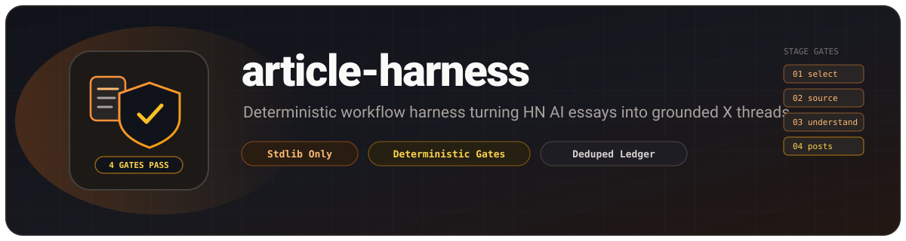
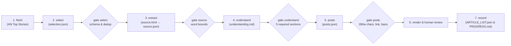

<p align="center">
  
</p>

<p align="center">
  <a href="https://www.python.org/downloads/"></a>
  
  <a href="https://github.com/aayushhzz/article-harness/stargazers"></a>
  <a href="https://github.com/aayushhzz/article-harness/issues"></a>
</p>

<p align="center">
  <a href="#workflow">Workflow</a> •
  <a href="#quick-start">Quick Start</a> •
  <a href="#cli-reference">CLI Reference</a> •
  <a href="#configuration">Configuration</a> •
  <a href="#project-structure">Project Structure</a> •
  <a href="docs/architecture.md">Architecture Docs</a>
</p>

---

**Article-to-X Harness** is a lightweight, zero-dependency (Python standard library only) workflow harness for turning high-signal Hacker News essays on AI and agentic engineering into grounded understanding notes and concise X threads.

The LLM reads and drafts; **deterministic Python gates** enforce source grounding, required sections, X weighted character limits, hype-phrase bans, topic filtering, and append-only deduplication.

## Workflow



See [CONTRACT.md](CONTRACT.md) for the non-negotiable definition of done and [docs/architecture.md](docs/architecture.md) for gate internals.

## Quick Start

Requires **Python 3.10+** (standard library only — no `pip install` or virtual environment required).

```bash
git clone https://github.com/aayushhzz/article-harness.git
cd article-harness

# 1. Fetch and filter top HN stories on AI / agentic engineering
python3 -m harness.article_harness fetch --day 2026-11-24

# 2. After writing runs/<day>/selection.json (using prompts/select.md), validate selection
python3 -m harness.article_harness gate select --day 2026-11-24

# 3. Download and extract article text into runs/<day>/source.json
python3 -m harness.article_harness extract --day 2026-11-24
python3 -m harness.article_harness gate source --day 2026-11-24

# 4. After writing runs/<day>/understanding.md and posts.json, run gates
python3 -m harness.article_harness gate understand --day 2026-11-24
python3 -m harness.article_harness gate posts --day 2026-11-24

# 5. Preview the resolved thread (substitutes {ARTICLE_URL})
python3 -m harness.article_harness render --day 2026-11-24

# 6. Inspect overall run status across all 4 gates
python3 -m harness.article_harness status --day 2026-11-24

# 7. Record outcome in ARTICLE_LIST.json and PROGRESS.md
python3 -m harness.article_harness record --day 2026-11-24 --status posted --thread-id 12345
# Or if rejected:
python3 -m harness.article_harness record --day 2026-11-24 --status rejected --reason "promotional announcement"
```

## CLI Reference

All commands are exposed via `python3 -m harness.article_harness <subcommand>` ([harness/article_harness.py](harness/article_harness.py)):

| Command | Key Flags | Purpose |
|---|---|---|
| `fetch` | `--day YYYY-MM-DD` | Pull top HN stories, filter by score/keywords/dedup, write `runs/<day>/candidates.json` |
| `extract` | `--day`, `--from-html` | Download article HTML (or re-parse local `source.html`) into `runs/<day>/source.json` |
| `gate` | `{select,source,understand,posts}`, `--day` | Run a deterministic validation gate (exit `0` on pass, `1` on failure) |
| `render` | `--day` | Print a dry-run preview of `posts.json` with `{ARTICLE_URL}` resolved |
| `status` | `--day` | Summarize PASS/FAIL status across all four gates for a run day |
| `record` | `--day`, `--status {posted,rejected}`, `--reason`, `--thread-id`, `--followup-id`, `--x-handle` | Append outcome to `ARTICLE_LIST.json` and log to `PROGRESS.md` |

## Configuration

All thresholds and filters live in [config.json](config.json):

- **`hn`**: `top_limit` (`60`), `min_score` (`50`), `topic_keywords` (AI/LLM/agentic terms), and `exclude_keywords` (hiring, fundraising, launch hype).
- **`source`**: `min_words` (`200`), `max_words` (`25000`), `timeout_seconds` (`15`).
- **`understanding`**: Required `##` sections (`Problem`, `Central point`, `Evidence`, `Limits and open questions`, `Angle`).
- **`x`**: `max_chars` (`280`), `url_weight` (`23`), `min_thread`/`max_thread` (`3`–`8`), `min_followups`/`max_followups` (`1`–`2`).
- **`banned_phrases`**: Clickbait phrases and thread-bait emojis rejected by `gate posts`.

## Project Structure

```text
article-harness/
├── assets/
│   └── banner.svg                # Repository hero banner
├── docs/
│   └── architecture.md           # Gate rules, HTML extractor, and ledger design
├── harness/
│   ├── __init__.py
│   └── article_harness.py        # CLI, HN fetcher, HTML parser, gates, renderer, ledger
├── prompts/
│   ├── select.md                 # Candidate selection prompt
│   ├── understand.md             # Grounded reading & breakdown prompt
│   ├── posts.md                  # X thread drafting prompt
│   └── review.md                 # Pre-publish quality review prompt
├── tests/
│   └── test_article_harness.py   # Offline unit tests for all stages & gates
├── ARTICLE_LIST.json             # Append-only ledger of posted/rejected articles
├── CONTRACT.md                   # Definition of done and hard constraints
├── PROGRESS.md                   # Append-only timestamped progress log
├── config.json                   # Topic filters, bounds, X rules, banned phrases
└── README.md
```

> `runs/<day>/` is gitignored and stores per-day artifacts (`candidates.json`, `selection.json`, `source.html`, `source.json`, `understanding.md`, `posts.json`).

## Testing

```bash
python3 -m unittest discover -s tests -v
```

---

<p align="center">
  Built by <a href="https://github.com/aayushhzz">aayushhzz</a> •
  <a href="https://github.com/aayushhzz/article-harness/issues">Report an Issue</a> •
  <a href="https://github.com/aayushhzz">More Projects</a>
</p>
